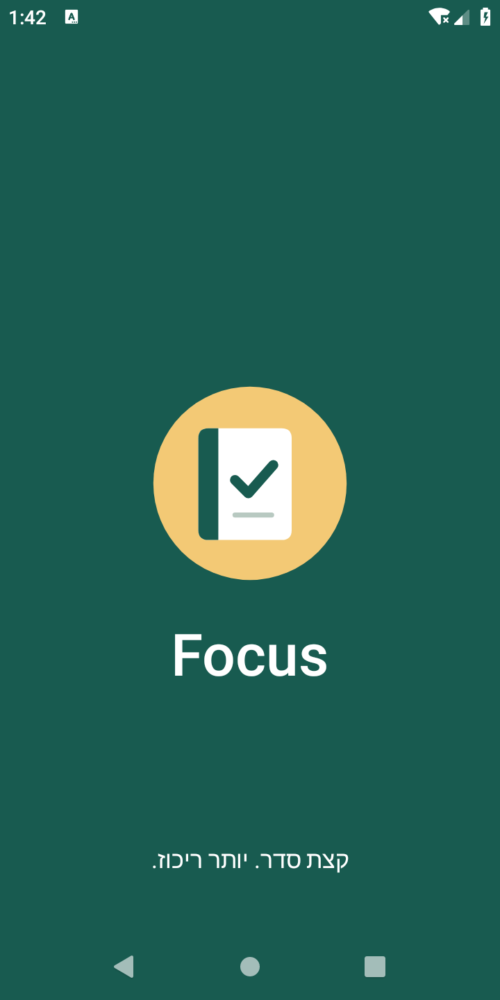
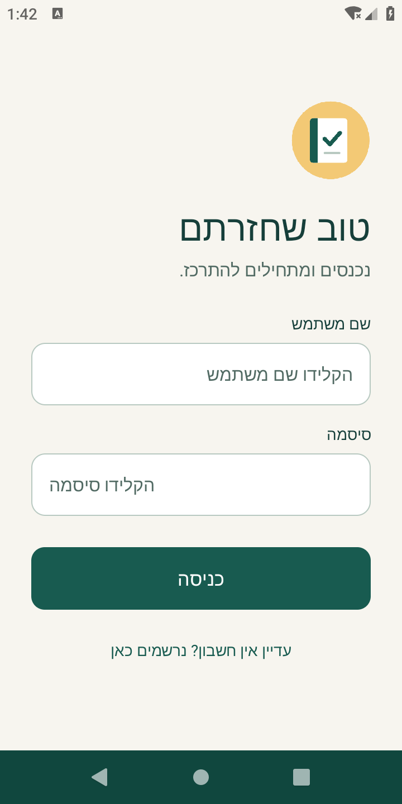
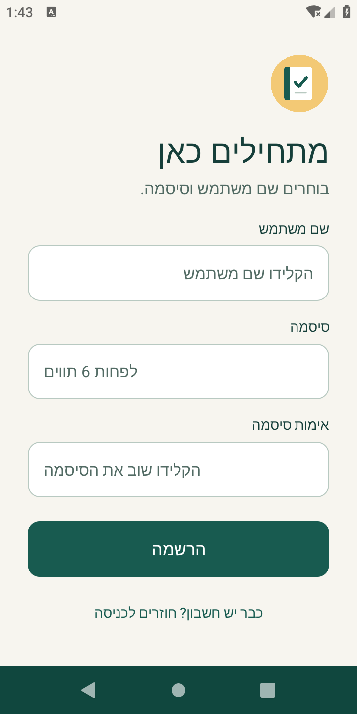

# Focus

פרויקט Android ב-Java עם שלושה מסכים: פתיחה, כניסה והרשמה.

## המסכים

- **מסך פתיחה:** סמל ממורכז עם הופעה הדרגתית וגדילה. אחרי 3 שניות עוברים למסך הכניסה. ההמתנה רצה ב-Thread נפרד.
- **מסך כניסה:** שם משתמש, סיסמה מוסתרת, כפתור כניסה וקישור להרשמה. יש בדיקה של שדות ריקים ושל הפרטים שהתקבלו מההרשמה.
- **מסך הרשמה:** שם משתמש, סיסמה ואימות סיסמה. הסיסמה צריכה להכיל לפחות 6 תווים, ושתי הסיסמאות צריכות להיות זהות. שגיאות מוצגות ליד השדה.

לאחר ההרשמה חוזרים למסך הכניסה עם שם המשתמש שכבר מולא. הפרטים עוברים בעזרת Intent extras בלבד, בלי קובץ או מסד נתונים. אחרי סגירה מלאה והפעלה חדשה צריך להירשם שוב. כניסה מוצלחת מציגה הודעה; אין מסך רביעי.

## צילומי מסך

### פתיחה

### כניסה

### הרשמה

## הרצה

1. פותחים את תיקיית הפרויקט ב-Android Studio.
2. ממתינים לסנכרון Gradle ומתקינים SDK חסר אם צריך.
3. בוחרים מכשיר או אמולטור עם Android 6.0 ומעלה ולוחצים Run.
4. נרשמים עם שם משתמש וסיסמה לבחירתכם, ואז נכנסים עם אותם פרטים.

הגדרות הבנייה: JDK 17, Gradle 8.9, Android Gradle Plugin 8.7.3, compile SDK 35, Build Tools 35.0.0 ו-target SDK 34. קוד האפליקציה אינו תלוי בספריות חיצוניות.

## עיצוב

הצבעים והסמל משותפים לשלושת המסכים. הסמל הוא Vector Drawable שנמצא בפרויקט, בלי תמונות חיצוניות. כיוון הטפסים הוא מימין לשמאל. הטפסים ניתנים לגלילה כשהמקום במסך לא מספיק.

לפני העיצוב נערך חיפוש של דוגמאות למסכי כניסה ב-[Behance](https://www.behance.net/search/projects/login%20screens?locale=en_US). הן שימשו להשראה כללית בלבד.
